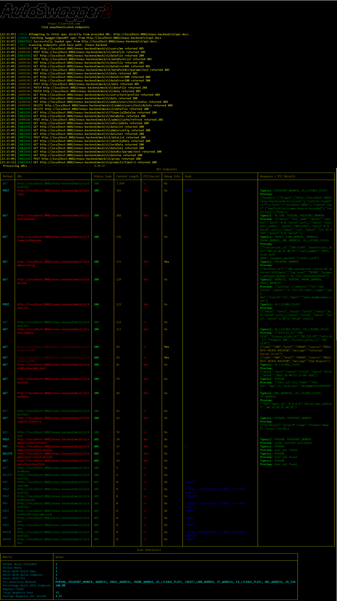

# [AutoSwagger2](https://github.com/javaguru/autoswagger2) by **[Franck Andriano.](http://jservlet.com)**

[](https://github.com/javaguru/autoswagger2/actions/workflows/dynamic/github-code-scanning/codeql)
[](https://github.com/javaguru/autoswagger2/actions/workflows/tests.yml)
[](https://www.python.org/)
[](LICENSE)


<br>  
<br>  

This tool is a significantly enhanced version of the original **[Autoswagger](https://www.intruder.io/research/broken-authorization-apis-autoswagger)**, created by Cale Anderson at [Intruder](https://intruder.io/).

## Overview

AutoSwagger2 is a command-line utility designed to automate the security assessment of OpenAPI/Swagger-based APIs. The tool automates the process of discovering API specifications, enumerating defined endpoints, and systematically testing them for vulnerabilities such as Personally Identifiable Information (PII) exposure, credential leakage, Broken Object Level Authorization (BOLA), and Broken Function Level Authorization (BFLA).

The utility leverages the **Presidio** library for advanced PII recognition and a comprehensive set of **TruffleHog-inspired regular expressions** for the detection of sensitive keys and tokens.

## Legal Disclaimer

### Authorized and Ethical Use

The use of AutoSwagger2 is strictly reserved for authorized penetration testing, security audits, or academic research. Executing this tool against targets without prior and explicit authorization from the system owner is illegal and constitutes a violation of cybercrime laws.

### Limitation of Liability

The author of this software disclaims all liability for any use made of it. In no event shall the author be held liable for any direct or indirect damages, data loss, service interruptions, or legal proceedings resulting from the use, misuse, or inability to use this tool.

### User Responsibility

It is the end user's responsibility to ensure that their activities comply with applicable local, national, and international legislation. The user assumes full responsibility for the consequences related to the requests sent by the tool, particularly regarding the load on target servers or the exposure of sensitive data.

### Software Nature

This software is provided "as is," without warranty of any kind, express or implied. The user acknowledges using this tool at their own risk.

## ⚡ Key Features Innovations

* **Advanced Specification Discovery:** Employs a multi-phase discovery process (direct parsing, Swagger UI HTML and JavaScript resource inspection, context-aware path probing, and root fallback), ensuring compatibility with modern frameworks such as Spring Boot. Includes an **atomic SHA-256 disk cache** with configurable TTL (`--cache-ttl`, default `3600s`) and explicit bypass (`--no-cache`).

* **Undocumented / `@Hidden` Endpoint Discovery (`--hidden`):** Before scanning documented OpenAPI paths, optionally inventories undocumented routes omitted from the schema (e.g., SpringDoc `@Hidden`, `@ApiIgnore`, or `include_in_schema=False` controllers such as `/v1/echo` or `/actuator/env`). Derives version/namespace prefixes directly from the OpenAPI specification, filters SPA/catch-all soft-404s via per-prefix canary baselines, recovers missing query parameters on `400`/`422`, detects `405` non-`GET` routes (`Allow` header), and supports custom route lists via `--hidden-wordlist FILE`.

* **Extensive OpenAPI Support:** Precise version detection (Swagger 2.0, OpenAPI 3.0.x, OpenAPI 3.1), **recursive `$ref` resolution with cycle detection**, `allOf` / `oneOf` / `anyOf` schema composition, OpenAPI 3.1 type arrays (e.g., `["string", "null"]`), `servers` template variable expansion, path/operation parameter merging, `multipart/form-data` payloads, and native support for OpenAPI 3.1 Webhooks (safely skipping unresolved runtime expressions).

* **Comprehensive Security Testing:**

    * **PII & Secret Detection:** Uses a calibrated **Presidio** NLP/regex pipeline (case-sensitive patterns, compact-JSON context validation, generic-label filtering, and longest-span overlap deduplication) combined with **TruffleHog-inspired patterns** covering JWTs (with automatic signature masking), Asymmetric Keys (RSA, ed25519), cloud/payment API keys (AWS, Stripe, Google, OpenAI, GitHub, generic JSON `"apikey"` fields), and database/JDBC connection URIs. Also performs **Sensitive Parameter Detection** (CWE-598) and passive LFI/SQL/XSS response anomaly checks.

    * **Authorization & Resource Testing:** Differential, baseline-aware checks respecting read-only mode by default (`POST`/`PUT`/`PATCH`/`DELETE` require `-risk`):
        * **BOLA (`--bola` / `--test-bola`):** Compares neighbor IDs (integers, prefixed/suffixed IDs, UUIDs, MongoDB ObjectIDs) against a verified baseline while ignoring error envelopes.
        * **BFLA (`--test-bfla`):** Probes administrative paths (`admin`, `management`, `internal`, `config`, `actuator`, etc.) while filtering soft-200 error responses.
        * **BOPLA (`--test-bopla`):** Injects privileged JSON properties (e.g., `"isAdmin": true`, `"role": "admin"`) into `POST`/`PUT`/`PATCH` schema-generated bodies.
        * **URC (`--test-urc`):** Evaluates pagination boundaries (`limit`, `size`, `page`, etc.) by comparing extreme values against a normal baseline request for latency spikes or oversized responses.

    * **Dynamic Parameter Probing:** Populates path, query, header, and body parameters from OpenAPI schemas and `TEST_VALUES` payloads, using a linear `O(N)` parameter strategy in brute-force mode (`-b`) to avoid exponential request explosions.

    * **Debug Information Analysis:** Identifies server misconfigurations by detecting stack traces, database error messages, and exposed environment variables while minimizing generic JSON noise.

* **Security-by-Default Transport & Origin Policy:** TLS certificate verification is enforced by default (use `-k` / `--insecure` explicitly for self-signed dev/staging certs). Redirects and cross-origin spec/webhook URLs are blocked by default under a strict Same-Origin policy; enabling `--allow-external` permits cross-origin fetches while automatically stripping `Authorization`, `Cookie`, and API key headers. HTML and CSV reports escape untrusted output and spreadsheet formulas.

* **Support for Authenticated Scanning:** Credentials can be supplied via custom headers (`-H` / `--header`), `--api-key`, or `--api-key-src` (reading long tokens from a file).

* **Structured Reporting:** Presents findings in Rich console tables, JSON (`-json` / `-product`), CSV (`-csv`), SARIF (`-sarif`), or HTML (`-html`), with severity filtering (`-severity critical|high|medium|low`) and runtime statistics (`-stats`).

* **High-Performance Concurrency & Rate Limiting:** Lazy thread-safe SpaCy/Presidio engine singleton, bounded `HTTPAdapter` connection pooling, URL-to-endpoint thread budget splitting (`-t` / `--threads`, default `20`, max `100`), a thread-safe global rate limiter (`-rate`, default `30` req/s), and automatic retries with exponential backoff.

## Installation & Usage

1. **Clone the repository:**

   ```bash
   git clone https://github.com/javaguru/autoswagger2.git
   cd autoswagger2
   ```

2. **Install dependencies** (Python 3.10+ / 3.12+ recommended; `requirements.txt` includes the SpaCy `en_core_web_lg` model):

   ```bash
   python -m venv venv

   # Linux / macOS
   source venv/bin/activate

   # Windows (PowerShell)
   .\venv\Scripts\Activate.ps1

   pip install -r requirements.txt
   ```

   *(Optional — for contributors / running the test suite from the repository root)*:

   ```bash
   pip install -r autoswagger2/tests/requirements-dev.txt
   python -m pytest
   ```

3. **Execute the tool:**

   ```bash
   # Display the help message for a full list of options.
   python -m autoswagger2 -h

   # Execute a safe read-only scan against a target URL.
   python -m autoswagger2 https://api.example.com -stats
   ```

## Options

```text
usage: autoswagger2 [-h] [-V] [-v] [-rate RATE] [-k]
                    [--openapi-version OPENAPI_VERSION] [-risk] [-all] [-b]
                    [--test-bfla] [--test-bopla] [--test-urc]
                    [--allow-external] [-t THREADS] [--no-cache]
                    [--cache-ttl CACHE_TTL] [--hidden]
                    [--hidden-wordlist FILE] [-H] [--api-key] [--api-key-src]
                    [--key-header] [--key-prefix] [--user-agent UA] [--bola]
                    [--bola-id "param=id"] [-product] [-stats] [-json] [-csv]
                    [-sarif] [-html] [--out FILE]
                    [-severity {critical,high,medium,low}]
                    [urls ...]

AutoSwagger2: Detect unauthenticated access control issues via Swagger2/OpenAPI documentation.

positional arguments:
  urls                  Base URL(s) or spec URL(s) of the target API(s)

options:
  -h, --help            show this help message and exit
  -V, --version         show program's version number and exit
  -v, --verbose         Enable verbose output
  -rate RATE            Set the rate limit in requests per second (default: 30). Use 0 to disable rate limiting.
  -k, --insecure        Disable SSL/TLS certificate verification.
  --openapi-version OPENAPI_VERSION
                        Force OpenAPI version detection (e.g. 2.0, 3.0.1, 3.0.4, 3.1). If not specified, auto-detect.

Scan Behavior:
  -risk                 Include non-GET requests in testing
  -all                  Include all HTTP status codes in the results, excluding 401 and 403
  -b, --brute           Enable exhaustive testing of parameter values.
  --test-bfla           Test for Broken Function Level Authorization (BFLA). Requires an auth header.
  --test-bopla          Test for Broken Object Property Level Authorization (BOPLA).
  --test-urc            Test for Unrestricted Resource Consumption (DoS).
  --allow-external      Allow following cross-origin spec and webhook URLs (authentication headers are never sent cross-origin).
  -t THREADS, --threads THREADS
                        Maximum concurrent worker threads (default: 20, max: 100).
  --no-cache            Disable specification disk cache reading and writing.
  --cache-ttl CACHE_TTL
                        Specification cache TTL in seconds (default: 3600).
  --hidden              Discover undocumented endpoints (e.g., Spring @Hidden routes) via dictionary probing before scanning documented paths.
  --hidden-wordlist FILE
                        Custom wordlist file (one path suffix per line) to include during --hidden discovery.

Authentication:
  -H , --header         Add a custom Key:Value header to all requests (e.g., "Authorization: Bearer ...")
  --api-key             API key/token for authentication.
  --api-key-src         File containing the API key/token (useful for long tokens).
  --key-header          Header name for the API key/token (default: Authorization).
  --key-prefix          Prefix for the API key/token value (default: "Bearer "). Use "" for no prefix.
  --user-agent UA       Specify a custom User-Agent header for all requests.

BOLA Testing:
  --bola, --test-bola   Enable BOLA testing mode.
  --bola-id "param=id"  Parameter name and your ID for BOLA baseline (e.g., "userId=123").

Output:
  -product              Output all endpoints in JSON, flagging those that contain PII or have large responses.
  -stats                Display scan statistics. Included in JSON if -product or -json is used.
  -json                 Output results in JSON format in default mode.
  -csv                  Output results in CSV format.
  -sarif                Output results in SARIF format.
  -html                 Output results in HTML format.
  --out FILE            Save output to file (used with -csv, -sarif, -html).
  -severity {critical,high,medium,low}
                        Filter results by minimum severity level (critical, high, medium, low).
```

## Discovery Phases

`AutoSwagger2` employs a sophisticated multi-phase process to locate the OpenAPI specification, commencing with direct methods and subsequently reverting to broader discovery techniques.

### Phase 1: Direct URL Analysis

The initial phase involves a direct analysis of the user-provided URL:

1. **Direct Spec File:** The tool first determines if the URL directly references a specification file (i.e., ending in `.json`, `.yaml`, or `.yml`). If so, it proceeds with immediate parsing.

2. **Swagger UI Page:** If the URL does not point to a spec file, it is assessed as a potential Swagger UI HTML page. If confirmed, the page's content and linked JavaScript resources (e.g., `swagger-initializer.js`) are parsed to extract the definitive specification URL. This process accommodates modern configurations, including `configUrl` objects and dynamic URL variables.

### Phase 2: Context-Aware Discovery

Should Phase 1 fail to yield a specification, the tool presumes the provided URL constitutes an application base path and initiates a targeted search from that location.

1. **Known UI Paths:** A comprehensive list of common Swagger UI paths (e.g., `/swagger-ui.html`, `/api/docs`) is tested relative to the provided URL.

2. **Direct Spec Paths:** Subsequently, a list of common direct specification file paths (e.g., `/v2/api-docs`, `/openapi.json`) is tested, also relative to the provided URL.

### Phase 3: Root Fallback Discovery

If the context-aware search is unsuccessful and the initial URL was not the server root, a final fallback procedure is executed:

1. **Root Search:** The entirety of the "Context-Aware Discovery" process is repeated, commencing from the server's root (`/`). This step is crucial for identifying specifications in applications not deployed at the domain's root.

The discovery process concludes upon the successful parsing of a valid OpenAPI specification.

## Undocumented / Hidden Endpoint Discovery (`--hidden`)

Modern API frameworks allow developers to hide routes from generated OpenAPI specifications—for example, SpringDoc's `@Hidden` annotation, Springfox's `@ApiIgnore`, or FastAPI's `include_in_schema=False` (OWASP API9: Improper Inventory Management).

When `--hidden` (or `--hidden-wordlist FILE`) is enabled, `AutoSwagger2` runs an undocumented route discovery phase **before** scanning the documented endpoints in the schema:

1. **Context-Aware Prefix Derivation:** Automatically extracts API namespace and version prefixes from the discovered OpenAPI `paths` (e.g., `/mock/v1`, `/v1`, `/api/v1`) in addition to the resolved `basePath` / `servers` context path. Even if no OpenAPI specification is exposed on the target, `--hidden` still probes standard API prefixes under the target URL.
2. **Dictionary + Custom Wordlist:** Combines a curated built-in dictionary of diagnostic, operational, and Spring Boot Actuator routes (`echo`, `ping`, `health`, `status`, `info`, `env`, `config`, `debug`, `actuator/*`, etc.) with any custom route suffixes supplied via `--hidden-wordlist FILE`, while automatically skipping paths already documented in the OpenAPI schema.
3. **Canary Baseline Filtering (Zero Soft-404 Noise):** Sends one non-existent canary probe per prefix to fingerprint catch-all responses (such as Single-Page Application `200 OK` HTML fallbacks or custom JSON not-found envelopes) and discards matching responses.
4. **Parameter & Method Recovery:**
   * If a `GET` probe returns `400`/`422` (indicating an existing route with a missing `@RequestParam`), automatically retries once with extracted/common benign query parameters (e.g., `?msg=test&message=test...`).
   * If a `GET` probe returns `405 Method Not Allowed`, inspects the `Allow` header—reporting allowed methods safely in read-only mode, or testing `POST`/`PUT` automatically when `-risk` is enabled.
5. **Full PII/Secret Analysis & Reporting:** Every discovered undocumented endpoint undergoes full Presidio PII, secret regex, and debug info inspection, and is flagged with `Undocumented Endpoint (@Hidden)` across the Rich console table, JSON, CSV, SARIF, and HTML reports.

```bash
# Discover @Hidden endpoints (such as /v1/echo) before scanning documented schema endpoints
python -m autoswagger2 https://api.example.com --hidden -stats

# Include non-GET @Hidden routes (-risk) and a custom wordlist file
python -m autoswagger2 https://api.example.com --hidden --hidden-wordlist custom-routes.txt -risk -stats
```

## Endpoint Testing

Upon successful parsing of a specification, the utility initiates a systematic testing protocol for each defined endpoint.

1. **Endpoint Collection**
   Every path and method defined under `paths` (and `webhooks` in OpenAPI 3.1) is extracted, resolving `$ref` pointers (including nested and cyclic references) and `allOf` / `oneOf` / `anyOf` compositions.

2. **HTTP Method Selection**

    * By default, only safe read-only methods (`GET`, `HEAD`, `OPTIONS`) are dispatched.

    * The `-risk` flag enables testing of state-changing methods (`POST`, `PUT`, `PATCH`, `DELETE`).

3. **Authentication, TLS & Same-Origin Policy**

    * **TLS Verification:** Certificate verification is enabled by default (`verify=True`). Use `-k` / `--insecure` explicitly when auditing local or staging targets with self-signed certificates.

    * **Same-Origin Protection:** Cross-origin redirects and remote `servers` / webhook URLs are blocked by default. Adding `--allow-external` allows following external URLs while automatically stripping sensitive headers (`Authorization`, `Cookie`, API keys) whenever a request leaves the target origin.

    * **Authenticated (Optional):** Credentials may be provided via command-line arguments:

        * `-H` / `--header`: For any custom header (e.g., `Authorization: Bearer <token>`). Can be specified multiple times.

        * `--api-key` / `--api-key-src`: Supply a bearer token or custom header key (`--key-header`, `--key-prefix`) inline or from a file.

        * `--user-agent`: Specify a custom User-Agent string.

4. **Parameter & Body Generation**

    * **Path & Query Parameters:** URL path and query string parameters are populated from OpenAPI `enum`s, schema types (including OpenAPI 3.1 type arrays such as `["string", "null"]`), and `TEST_VALUES`.

    * **Request Bodies:** For methods such as `POST` and `PUT`, request bodies are generated from resolved JSON or `multipart/form-data` schemas.

    * **Brute-Force Mode (`-b` / `--brute`):** Uses a linear One-Parameter-At-A-Time strategy (`O(1 + sum(len(V_i) - 1))`) so endpoints with many parameters remain fast while every value variant is covered.

5. **Concurrency, Caching & Rate Limiting**

    * **Bounded Threads (`-t` / `--threads`):** Controls total concurrency (default `20`, max `100`), automatically splitting worker budgets across multiple URLs and sizing the HTTP connection pool accordingly.

    * **Global Rate Limiter (`-rate`):** Uses a thread-safe slot-reservation limiter across discovery, endpoint probing, and BOLA/BFLA/BOPLA/URC modules (default `30` req/s; `0` disables).

    * **Discovery Cache (`--no-cache`, `--cache-ttl`):** Caches validated specifications using SHA-256 keys and atomic writes with a `3600s` default TTL. Pass `--no-cache` to bypass disk caching.

6. **Response Analysis**

    * Each response is evaluated by status code, content length, content type, and passive vulnerability indicators (LFI, SQL errors, reflected XSS).

    * Text-based responses undergo calibrated PII (Presidio), secret (TruffleHog regexes + JDBC/API key patterns), and debug info analysis.

## BOLA Testing

`AutoSwagger2` can automate the detection of Broken Object Level Authorization (BOLA) vulnerabilities. This test checks if an authenticated user can access resources belonging to other users by manipulating object IDs in the URL.

### How it Works

1.  **Activation:** Enable with `--bola` (or `--test-bola`) alongside authentication headers (`-H`) and the user's own object ID (`--bola-id "param=id"`).
2.  **Target Identification:** Identifies all endpoints in the specification that use the specified object ID path parameter (e.g., `/api/users/{userId}/profile`). Only safe HTTP methods are probed unless `-risk` is specified.
3.  **Baseline Request:** Sends a request with the user's own ID to establish a verified successful baseline (status, structure, and length).
4.  **Attack Phase:** Detects the baseline ID format and generates neighbor or fallback IDs:
    *   **Integers:** Adjacent numbers (e.g., `122`, `124` for `123`).
    *   **UUIDs:** Adjacent hex values and a random UUIDv4.
    *   **MongoDB ObjectIDs:** Incrementing/decrementing the trailing segment of a 24-char hex ObjectID.
    *   **Prefixed/Suffixed Integers:** Increments/decrements the embedded integer while preserving prefixes/suffixes (e.g., `usr-122`, `usr-124`).
    *   **Fallback Strings:** Common administrative/default strings (e.g., `admin`, `guest`, `root`, `user`, `test`).
5.  **Verification:** Flags BOLA only when the neighbor response succeeds without matching a soft-error envelope and shows matching status/structure similarity relative to the baseline.

### Example Usages

#### 1. Testing with a Standard Integer ID
```bash
python -m autoswagger2 https://api.example.com \
  -H "Authorization: Bearer <your_auth_token>" \
  --bola \
  --bola-id "userId=123"
```

#### 2. Testing with a UUID
```bash
python -m autoswagger2 https://api.example.com \
  -H "Authorization: Bearer <your_auth_token>" \
  --bola \
  --bola-id "userId=123e4567-e89b-12d3-a456-426614174000"
```

#### 3. Testing with a MongoDB ObjectID
```bash
python -m autoswagger2 https://api.example.com \
  -H "Authorization: Bearer <your_auth_token>" \
  --bola \
  --bola-id "userId=507f1f77bcf86cd799439011"
```

#### 4. Testing with a Prefixed Identifier
```bash
python -m autoswagger2 https://api.example.com \
  -H "Authorization: Bearer <your_auth_token>" \
  --bola \
  --bola-id "userId=usr-123"
```

The results are displayed in a separate table at the end of the scan.

## BFLA Testing

`AutoSwagger2` can test for Broken Function Level Authorization (BFLA) by attempting to access administrative endpoints with a non-administrative user's session.

### How it Works

1.  **Activation:** Enable with `--test-bfla` alongside a non-privileged user's authentication header (`-H`).
2.  **Target Identification:** Matches path segments against privileged keywords (`admin`, `management`, `internal`, `debug`, `config`, `actuator`, `backoffice`, etc.) without false-triggering on prefixes like `/mock` or `/test` or substring collisions. Safe methods run by default; add `-risk` to include state-changing admin routes.
3.  **Attack Phase:** Dispatches requests to candidate privileged routes with the non-admin session.
4.  **Verification:** Flags BFLA when an administrative route returns a `2xx` status whose body is not an authorization/error JSON envelope.

### Example Usage

```bash
python -m autoswagger2 https://api.example.com \
  -H "Authorization: Bearer <your_NON_ADMIN_token>" \
  --test-bfla
```

## BOPLA Testing

`AutoSwagger2` can test for Broken Object Property Level Authorization (BOPLA) by injecting sensitive properties into the request bodies of `POST`, `PUT`, and `PATCH` requests.

### How it Works

1.  **Activation:** Enable with `--test-bopla` (explicitly tests body-bearing `POST`/`PUT`/`PATCH` endpoints when requested).
2.  **Target Identification:** Identifies `POST`, `PUT`, and `PATCH` endpoints accepting JSON bodies (`application/json` or `+json`).
3.  **Payload Generation:** Constructs a valid baseline body from the resolved OpenAPI schema.
4.  **Attack Phase:** Injects privileged key-value pairs (e.g., `"isAdmin": true`, `"role": "admin"`) into the baseline payload.
5.  **Verification:** Flags BOPLA when the server returns a `2xx` success response (excluding soft-error envelopes).

### Example Usage

```bash
python -m autoswagger2 https://api.example.com --test-bopla
```

## URC Testing

`AutoSwagger2` can test for Unrestricted Resource Consumption (URC / DoS vulnerabilities) by injecting extreme values into pagination and size parameters.

### How it Works

1.  **Activation:** Enable with `--test-urc`.
2.  **Target Identification:** Identifies `GET` endpoints accepting pagination or count query parameters (e.g., `limit`, `size`, `page`, `offset`, `max`, `count`).
3.  **Baseline & Attack Phase:** Sends a small baseline request (`10`) first, then dispatches an extreme value (`999999`). Rate-limiter sleep time is strictly excluded from response latency measurements.
4.  **Verification:** Flags URC if the extreme request triggers a timeout, significant latency inflation (`>= 5s` above baseline), or excessive payload growth (`> 500 KB` and significantly larger than baseline).

### Example Usage

```bash
python -m autoswagger2 https://api.example.com --test-urc
```

## 🛠️ Progressive Tutorial & Use Cases

### 1. Safe Read-Only Reconnaissance + Undocumented (`@Hidden`) Route Inventory

Start with a non-destructive read-only scan (`GET` endpoints only) that also checks for undocumented routes such as Spring `@Hidden` `/v1/echo` endpoints:

```bash
python -m autoswagger2 https://api.example.com --hidden -v -stats
```

### 2. Local / Staging Audit (Fresh Spec Cache, Custom Rate & Threads)

When iterating against a local or staging service (bypassing cached specs, tolerating self-signed dev TLS with `-k`, and keeping server load controlled):

```bash
python -m autoswagger2 https://localhost:8443/api \
  --no-cache \
  -k \
  -t 10 \
  -rate 15 \
  -stats -v
```

### 3. Complete Authorized Security Audit (Endpoints + BOLA + BFLA + BOPLA + URC)

Run all access-control and resource-consumption modules (including state-changing endpoints via `-risk`) and export to CSV:

```bash
python -m autoswagger2 https://api.example.com \
  -H "Authorization: Bearer <your_token>" \
  -risk \
  --test-bola --bola-id "userId=123" \
  --test-bfla \
  --test-bopla \
  --test-urc \
  -stats \
  -csv --out full-report.csv
```

*(Tip: use `--allow-external` only if the spec intentionally delegates endpoints or webhooks to trusted external hosts; credential headers remain stripped cross-origin.)*

### 4. CI/CD Gate with SARIF & Severity Filtering

Export critical/high findings in SARIF for GitHub Security Alerts or GitLab/IDE triage:

```bash
python -m autoswagger2 https://api.example.com \
  -severity critical \
  -sarif --out sarif-report.sarif
```

### 5. Interactive HTML Report or JSON Pipeline Filtering

```bash
# Shareable HTML report (with OpenAPI version override and custom User-Agent)
python -m autoswagger2 https://api.example.com \
  --user-agent "SecurityAudit/2.0" \
  --openapi-version 3.1 \
  -html --out report.html

# Filter high-confidence PII/Secret JSON findings with jq
python -m autoswagger2 https://api.example.com \
  -severity high \
  -json | jq '.results[] | select(.pii_detected==true)'
```

## Response Analysis & Data Leakage Detection

`AutoSwagger2` extends beyond simple accessibility checks by performing a multi-layered analysis on the content of every successful response to identify potential data leaks.

### 1. High-Confidence Findings (PII & Secrets)

The script actively searches for high-confidence indicators of sensitive data exposure:

* **Personally Identifiable Information (PII):** Using the `presidio-analyzer` library, it performs context-aware scanning to pinpoint common PII such as:

    * Personal Identifiers: Names, Dates of Birth

    * Contact Information: Email Addresses, Phone Numbers, Physical Addresses

    * Financial Data: Credit Card Numbers, IBANs

    * National IDs: French INSEE Numbers, US Social Security Numbers

    * Other Identifiers: Passport Numbers, IP/MAC Addresses, License Plates (FR/US)

* **Secrets and Credentials:** It uses a calibrated suite of `TruffleHog`-inspired regular expressions to detect exposed credentials, including:

    * Cloud & Third-Party API Keys (AWS, Google Cloud, Stripe, OpenAI, GitHub, Slack, Discord) as well as generic `"apikey"` / `api_key` JSON and config entries

    * Database Connection URIs (`postgresql://`, `mongodb://`, `mysql://`, `redis://`, `jdbc:postgresql://`, etc.)

    * JSON Web Tokens (JWT) with automatic `[REDACTED]` signature masking in reports

    * Private keys (RSA, DSA, EC, ed25519, PGP) and credentialed URLs

Any finding in this category is considered a high-priority issue and is flagged under the **PII/Secret** column in the results table.

### 2. Low-Confidence Indicators (Debug Info & Data Exposure)

The script also looks for red flags that might not be secrets themselves but often indicate a misconfiguration or a potential information leak:

* **Debug Information:** It searches for stack traces (`Traceback`, Java/JVM `at ...`, `NullPointerException`), SQL error signatures (`SQLSTATE`, `ORA-`, `SQLException`), and leaked environment variable identifiers (`env.*`, `AWS_*`, `AZURE_*`) while avoiding noise from generic JSON booleans like `"debug": false`. These findings are flagged under the **Debug Info** column.

* **Large Responses:** As a heuristic, the script flags responses that are unusually large (e.g., containing `>= 100` JSON items/keys or `> 100` XML tags) or contain passive vulnerability indicators (LFI/SQLi/XSS), marking them as `interesting_response` in JSON output.

## Output

**AutoSwagger2** supports multiple output formats: formatted console tables (default), structured JSON (`-json` / `-product`), spreadsheets (`-csv`), security tooling integration (`-sarif`), and interactive reports (`-html`).

### Default Table View

By default, results are displayed in a formatted table in your terminal. This view is designed for quick manual analysis and highlights key information:

* **PII/Secret:** A clear "Yes/No" indicator, highlighted in red if potential secrets or PII are found.

* **Debug Info:** A separate "Yes/No" indicator for lower-priority findings like stack traces or error messages.

* **Body:** When using the `-risk` flag, this column shows the request body that was sent to the server.

### Multiple Output Formats

For automation and integration, you can use one of the several output options:

* **`-json`:** Outputs a detailed JSON array containing the "best" result for every tested endpoint. This is useful for custom scripting or manual review of all findings.

* **`-product`:** Produces a filtered JSON output containing **only** the endpoints that are considered "interesting" (i.e., those with PII/Secrets, debug info, or unusually large responses). This mode is ideal for feeding results into other security tools or for CI/CD pipelines where you only want to be alerted to potential issues.

* **`-csv`:** Exports the results as a standard Comma Separated Values file, making it easy to open in Excel or other spreadsheet tools.

* **`-sarif`:** Exports the results in the Static Analysis Results Interchange Format (SARIF). This format is natively supported by GitHub Security Alerts, VS Code, and other modern CI/CD tools.

* **`-html`:** Generates an interactive and visually appealing HTML report that can be opened in any web browser.

* **`--out <FILE>`:** Specifies the output file name for the `-csv`, `-sarif`, and `-html` formats. If omitted, a default name (e.g., `autoswagger_report.csv`) will be used.

### Statistics

* **`-stats`:** This flag can be combined with any other output option. It will add a "Scan Statistics" block at the end of the output, providing a summary of the scan (hosts tested, requests sent, etc.).

## Interpretation of Scan Results

The analysis of the data generated by `AutoSwagger2` necessitates a structured and methodical approach. Although the tool is designed for the rapid identification of potential security vulnerabilities, it is imperative that all findings undergo a process of manual verification. The following guide provides a framework for the prioritization and interpretation of the scan's output.

### Prioritization of Findings

The resultant data is presented in a manner intended to facilitate the immediate identification of critical issues. A hierarchical approach to the triage of these results is recommended.

#### Category 1: High-Confidence Indicators of Sensitive Data Exposure

**Primary attention should be directed toward any entry for which the `PII/Secret` column indicates an affirmative result.**

Such findings are to be considered of the highest criticality. An affirmative result signifies that the script has detected data that corresponds with a high degree of certainty to a known pattern for a secret credential (e.g., an API key, a JSON Web Token) or Personally Identifiable Information (PII).

* **Recommended Action:** These endpoints warrant immediate investigation. It is advised to utilize a tool such as `curl` or an API testing suite to replicate the request. A thorough examination of the complete server response is required to confirm the precise nature and context of the exposed data.

#### Category 2: Medium-Confidence Indicators of Misconfiguration

**Subsequent analysis should focus on entries where the `Debug Info` column is marked affirmative, or on endpoints associated with an unusually high `Content Length`.**

* **Debug Information:** The presence of application stack traces, verbose error messages, or environment variable names is indicative of a server-side misconfiguration. While not constituting a direct leakage of credentials, such information provides a significant tactical advantage to a potential adversary for the formulation of more sophisticated attacks.

* **Large Responses:** An endpoint that returns a response of considerable size (e.g., in excess of 100 kilobytes) may be indicative of an excessive data exposure vulnerability. This condition could suggest, for instance, the return of an entire database table where only a single record was anticipated.

* **Recommended Action:** A manual review of these endpoints is necessary to ascertain the context of the information leak. It must be determined whether the response constitutes a generic error or reveals sensitive internal architectural details.

#### Category 3: Analysis of Publicly Accessible Endpoints

**A final review should encompass all other endpoints that returned a `200 OK` status code.**

The primary function of `AutoSwagger2` is the identification of endpoints accessible without authentication. The public availability of an endpoint may be contrary to intended security policy, even in the absence of a direct PII or secret leak.

* **Recommended Action:** For each such endpoint, an evaluation must be made as to whether public access is appropriate. An endpoint such as `/api/v1/users` that enumerates all system users represents a significant vulnerability, irrespective of whether passwords are also exposed.

### Manual Verification Protocol

It is a mandatory step to independently confirm all automated findings. The output table provides the exact `Method` and `URL` required to replicate the request.

**Example of Replication using `curl`:**

Should the tool report a potential issue with the `POST /v1/user/get` endpoint, replication can be readily achieved. If an authentication header was utilized during the initial scan, it must be included in any subsequent manual verification attempts.

```bash
# Example of a simple GET request
curl -X GET "https://api.example.com/v1/user/get"

# Example of a POST request with a request body and an authentication header
curl -X POST "https://api.example.com/v1/admin/action" \
-H "Authorization: Bearer <TOKEN_VALUE>" \
-H "Content-Type: application/json" \
-d '{"action": "create"}'
```

For more complex analysis and manipulation of requests, the use of specialized tools such as **Burp Suite** or **Postman** is recommended.

## Statistical Aggregation and Reporting

The `-stats` flag enables the aggregation and presentation of key scan metrics, providing a quantitative summary of the tool's execution and findings.

### Metrics Collected

When enabled, the following statistics are compiled:

* **Host Analysis:** The number of unique hosts provided, the number of active hosts that responded, the number of hosts for which a valid OpenAPI specification was successfully parsed, and the percentage of active hosts that yielded one or more valid endpoint responses.

* **Findings Summary:** The total number of hosts returning at least one endpoint with high-confidence PII or secret findings.

* **Request Metrics:** The total number of HTTP requests dispatched during the scan and the calculated average requests per second (RPS).

### Output Format

The presentation of these statistics is contingent upon the selected output mode:

* **Default Mode:** In the default operational mode, statistics are rendered in a formatted table at the conclusion of the scan.

* **JSON Mode:** When JSON output is selected via the `-json` or `-product` flags, these metrics are serialized and included as a `stats` object within the final JSON output.

## License

This project is an Open Source Software released under the [BSD 3-Clause License](https://github.com/javaguru/autoswagger2/blob/master/LICENSE).

## Authors - Acknowledgments

AutoSwagger2 [**Franck ANDRIANO.**](http://jservlet.com) - AutoSwagger was primarily maintained by [**Intruder**](https://intruder.io/) and primarily developed by Cale Anderson
